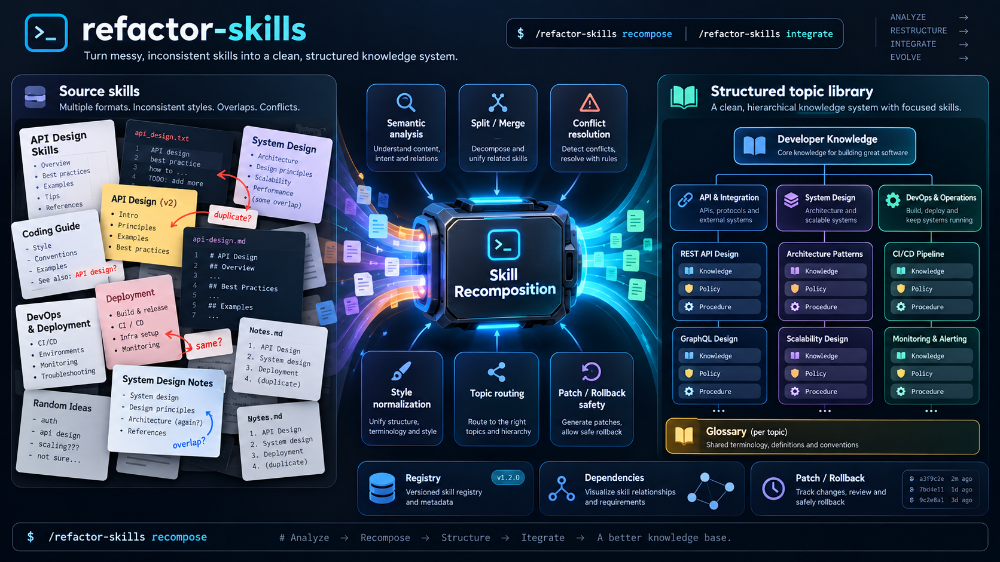

<div align="center">



<br />

# Skill Recomposition

**A modular Claude Code workflow for turning overlapping skills and skill systems into a structured, maintainable capability library.**

Recompose · Integrate · Audit · Validate · Roll back

[](https://docs.anthropic.com/en/docs/claude-code)
[](#how-it-works)
[](#repository-layout)
[](#safety-model)
[](#project-status)

[Commands](#commands) · [How it works](#how-it-works) · [Artifact model](#artifact-model) · [Repository layout](#repository-layout) · [Safety model](#safety-model)

</div>

---

Skill Recomposition is domain-agnostic. It can work on coding, writing, reasoning, research, motion design, highly specialized domain workflows, or any other skill set whose sources overlap, duplicate one another, conflict, or evolved independently.

The core idea is simple:

> **Preserve semantics and behavior, normalize structure, and produce focused capabilities with explicit execution policy.**

## How it works

Skill Recomposition first normalizes the supplied inputs. GitHub URLs are resolved into isolated, commit-pinned temporary source roots; local paths are used directly; and `integrate` can also consume a user intent document or create one interactively when no source is supplied. It then discovers what those inputs actually require or contain. A source may be nothing more than knowledge and instructions, a desired capability that does not exist yet, or a small runtime system with commands, delegated agents, hooks, scripts, manifests, rules, adapters, tests, and supporting references.

It then loads only the analysis tracks needed for those artifacts:

```text
explicit sources
      ↓
source discovery
      ↓
complexity plan
      ↓
┌─────────────────────┬──────────────────────┐
│ semantic analysis   │ runtime analysis     │
│ knowledge/policy    │ contracts/graph      │
└─────────────────────┴──────────────────────┘
      ↓
recomposition / integration
      ↓
validation + reversible commit
```

A knowledge-only skill therefore avoids the runtime-analysis machinery entirely. A behavior-heavy bundle receives deeper contract, dependency, host-layout, and runtime validation.

## Why this exists

Anthropic's skill model is built around progressive disclosure: keep lightweight routing information available, load full instructions only when relevant, and navigate supporting material only when needed. The stated goal is to **“minimize token usage while maintaining specialized expertise.”**<sup>[1]</sup>

That works best when boundaries and instructions stay precise. Anthropic also notes that Claude Code's success rate **“improves significantly with more specific instructions,”**<sup>[2]</sup> while Claude Code plugins expose distinct runtime surfaces for skills, commands, agents, hooks, MCP configuration, and helper scripts.<sup>[3]</sup> As a library grows, duplicated scope and conflicting policy are therefore only part of the maintenance problem: path contracts, entrypoints, event handlers, wrappers, and shared executables can drift too.

Skill Recomposition treats the whole system as maintainable architecture. It can dismantle semantic boundaries without flattening runtime behavior, then rebuild a focused topic hierarchy while preserving the contracts that make active artifacts work.

<sub>Sources: [1] [Anthropic — The Complete Guide to Building Skills for Claude](https://resources.anthropic.com/hubfs/The-Complete-Guide-to-Building-Skill-for-Claude.pdf) · [2] [Anthropic — Claude Code best practices](https://www.anthropic.com/research/claude-code-best-practices) · [3] [Anthropic — Claude Code plugin structure](https://github.com/anthropics/claude-code/blob/main/plugins/plugin-dev/skills/plugin-structure/SKILL.md)</sub>

## How to install

### Plugin marketplace (recommended)

```bash
/plugin marketplace add Shorii-Zoo/claude-skill-recomposer
/plugin install skill-recomposer@skill-recomposer
```

The repository acts as both marketplace catalog and plugin. The skill is explicitly invoked only; automatic model invocation is disabled to prevent unsolicited recomposition.

### Manual install

```bash
git clone https://github.com/Shorii-Zoo/claude-skill-recomposer.git \
  ~/.claude/skill-tools/skill-recomposer

mkdir -p ~/.claude/skills
ln -s ~/.claude/skill-tools/skill-recomposer/skills/skill-recomposer \
  ~/.claude/skills/skill-recomposer
```

When migrating from the old manual command install, remove only the old
`~/.claude/commands/skill-recomposer.md` symlink after verifying its target points
to this repository; keep customized files until reviewed. Installing both
entrypoints creates an ambiguous duplicate slash command.

Update later with:

```bash
git -C ~/.claude/skill-tools/skill-recomposer pull
```

## Commands

Mutable state lives outside the plugin/tool implementation:

```text
~/.claude/skill-tools/skill-recomposer-state/
```

### Recompose

Build a new managed topic tree from one or more ordinary source units:

```text
/skill-recomposer recompose <source-1> <source-2> ...
```

`recompose` is the default subcommand:

```text
/skill-recomposer <source-1> <source-2> ...
```

Preview only:

```text
/skill-recomposer recompose <source-1> <source-2> ... --dry-run
```

GitHub repositories and subtrees can be supplied directly:

```text
/skill-recomposer recompose \
  https://github.com/example/skill-pack \
  https://github.com/example/other-pack/tree/main/skills/my-skill
```

Supported remote forms include repository roots, `tree/<ref>/<subpath>` directories, and `blob/<ref>/<path>` files. The resolver records the exact commit SHA and explicit subpath for reproducible provenance, then removes the temporary checkout after the run.

A source can be a local skill/system path **or a GitHub URL**. GitHub repositories are resolved to an exact commit in an isolated temporary checkout before analysis; they do not need to be installed into Claude Code first. Repository/broad roots are analyzed but are never treated as disposable user-owned sources.

### Integrate

Integrate existing source material into a managed topic tree:

```text
/skill-recomposer integrate <source-1> [<source-2> ...]
```

Remote sources work the same way:

```text
/skill-recomposer integrate \
  https://github.com/example/skill-pack/tree/main/skills/new-capability
```

You can also integrate a **desired capability that does not exist yet** from a Markdown intent document:

```text
/skill-recomposer integrate ./my-intent.md
```

A starter format is available at `templates/intent.md`. The frontmatter marker is recommended but not required; Skill Recomposer can recognize a Markdown document that primarily describes a desired future capability rather than an existing artifact definition.

Or omit the source entirely:

```text
/skill-recomposer integrate
```

Claude then runs an adaptive question/answer session to clarify the goal, behavior, constraints, non-goals, interfaces, and acceptance criteria that actually matter. It writes the normalized intent to:

```text
~/.claude/skill-tools/skill-recomposer-state/intents/<intent-id>.md
```

That intent document enters the normal integration pipeline. If it only asks for knowledge/policy, runtime analysis stays unloaded; if it requires a command, agent, hook, script, config, adapter, evaluation, or another active surface, only the relevant tracks are enabled.

Optional topic anchor works for every integration source type:

```text
/skill-recomposer integrate <source-1> --topic <topic-id-or-name>
/skill-recomposer integrate --topic <topic-id-or-name>
```

The explicit topic defines the allowed subtree, not a placement preference. Inside that subtree, semantic placement remains leaf-first.

If no existing topic can cover the incoming semantic scope, a new root topic is created.

### Check

Read-only integrity check:

```text
/skill-recomposer check [<topic-id-or-name>]
```

Checks semantic state and, when present, active runtime surfaces such as commands, agents, hooks, scripts, configs, adapters, and evaluations.

### Audit

Report-only audit:

```text
/skill-recomposer audit <topic-id-or-name>
```

Apply repairs:

```text
/skill-recomposer audit <topic-id-or-name> --fix
```

Preview repairs:

```text
/skill-recomposer audit <topic-id-or-name> --fix --dry-run
```

Audit includes topic rebalancing, artifact graph integrity, routing/policy review, host-layout validation, and runtime-contract drift.

Repair mode requires an existing registry; missing state is never seeded. A parseable but invalid or inconsistent registry can be diagnosed and repaired transactionally with a readable recoverable snapshot stored outside the patch payload. The patch retains the original invalid registry bytes as its before-image; rollback and recovery use the patch, not the snapshot. Repair requires a parsed JSON mapping and an `operations` list whose history can be preserved unchanged. An unreadable registry or history that cannot be preserved blocks repair. Full registry bytes are forensic; rollback restores known invalid managed fields through the projection excluding `operations`, merging the live ledger rather than overwriting it. Report-only audit remains read-only.

### Rollback

```text
/skill-recomposer rollback <operation-id>
```

Preview:

```text
/skill-recomposer rollback <operation-id> --dry-run
```

Rollback verifies hashes, metadata, dependency history, and runtime preconditions before reversing a mutation. It restores recorded managed prestate: other files retain exact bytes; the registry restores its managed projection (all top-level fields except `operations`) and merges the live append-only ledger. Canonical JSON projection digests, not whole-registry byte hashes, establish applicability and restoration. Every committed ledger entry survives rollback, which appends its own entry after validation. Pre-existing invalid managed fields repaired by `audit --fix` are restored and reported faithfully, not silently corrected.

## Source eligibility

Recomposition-managed output cannot be fed back into `recompose` or `integrate` as ordinary source material. Managed artifacts may still be changed as targets by `integrate`, `audit --fix`, rollback, and maintenance.

Provenance is checked through registry state, local markers where safe, and stored output fingerprints.

For GitHub sources, provenance is pinned to the canonical repository URL, the resolved full commit SHA, and the explicitly requested subpath. Temporary checkout paths are never part of durable lineage. Remote source acquisition uses `git`, does not install the source into Claude Code, and does not execute source-provided scripts during resolution/discovery.

Intent documents are requirement inputs rather than pre-existing skill-system artifacts. User-authored intent files are never auto-deleted. Interactive intents are persisted outside active Claude discovery paths and retained as provenance/history inputs. They are valid only for `integrate`, not `recompose`.

Source deletion is conservative:

- explicitly supplied local sources of either `recompose` or `integrate`, classified as `disposable-source-unit`, MUST be deleted automatically after successful validated commit; the invocation itself authorizes deletion, without another confirmation, deletion flag, or consent step;
- this authorization does not extend to analysis-only inputs or non-disposable sources; deletion remains transactional, and dry-run, failed validation, or an uncommitted operation leaves sources untouched;
- user-owned repository roots, broad directories, and uncertain sources are never automatically deleted;
- resolver-owned GitHub checkouts are ephemeral workspaces and are simply cleaned after the run, never recorded as deleted upstream sources;
- user-authored and persisted interactive intent documents are input evidence and are never deleted as disposable source skills.

## Artifact model

Skill Recomposition treats the following as first-class artifacts when present:

| Kind | Role |
| --- | --- |
| `skill` | Routable knowledge/workflow bundle |
| `command` | Explicit user-facing entrypoint or compatibility shim |
| `agent` | Delegated execution context with its own runtime/tool contract |
| `hook` | Event/lifecycle-triggered behavior |
| `script` | Deterministic executable helper |
| `rule` | Persistent or broadly scoped policy surface |
| `config` | Manifest, MCP/LSP/server, plugin, or runtime configuration |
| `reference` | Knowledge, templates, examples, schemas, or assets |
| `evaluation` | Tests, evals, fixtures, and verification cases |
| `adapter` | Host-specific wrapper around a canonical capability |
| `unknown` | Preserved material that cannot yet be classified safely |

Unknown or potentially active artifacts are preserved rather than deleted.

### Runtime contracts

Active artifacts are not merged from textual similarity alone. Recomposition can track contracts such as:

- public names and invocation identifiers;
- activation mode and event matchers;
- arguments and input/output shapes;
- exit/error semantics;
- environment variables;
- permissions, tools, model, or isolation;
- filesystem/network/process side effects;
- paths and host discovery rules;
- ordering, timeout, concurrency, and lifecycle behavior.

A rename, split, merge, or move is only safe when every runtime-critical consumer is migrated, preserved, or served by a compatibility shim.

## Design principles

### Knowledge Space vs Execution Policy

Generated semantic skills distinguish what Claude should **know** from what Claude should **do**:

- **Knowledge Space** may preserve multiple valid approaches, trade-offs, concepts, and exceptions.
- **Execution Policy** resolves runtime behavior through defaults, precedence, conditions, exceptions, and overrides.
- **Procedure** defines how the selected behavior is carried out.

Conceptual plurality is allowed. Runtime ambiguity is not.

### Focused capabilities

Source file boundaries are non-authoritative. One source may split across many target skills; several source skills may contribute to one target; runtime support may remain shared instead of being duplicated into each skill.

### Logical topics vs physical layout

Topics are semantic hierarchy. Physical paths must also satisfy the host/runtime discovery contract.

A command, hook, agent, executable, or manifest is not nested differently merely to make the topic tree look tidy. Logical ownership lives in the registry when filesystem nesting would break discovery.

### Canonical style

Source presentation is non-authoritative. Generated documentation is normalized for language, terminology, normative vocabulary, structure, naming, examples, and Knowledge/Policy/Procedure separation.

Code/configuration syntax and public runtime identifiers are not rewritten for aesthetic uniformity.

### Minimal change during integration

Existing topic and runtime architecture is preserved unless correctness, containment, dependency integrity, or contract preservation requires restructuring. Managed target skills may still be rewritten deeply when necessary.

## Managed topic model

Topics provide semantic scope for managed artifacts and may define:

- child topics;
- artifact membership;
- topic invariants;
- a recursively inherited `GLOSSARY.md`;
- style metadata;
- shared references/support;
- dependency and supersession relationships.

### Topic glossary

Every topic has a `GLOSSARY.md`. Terms live at the highest topic where their meaning remains valid for the whole subtree. Child topics may explicitly specialize inherited meanings but cannot silently redefine them.

### Topic invariants

Stable subtree-wide constraints belong in topic invariants rather than being duplicated into every descendant skill.

### Dependency graph

The registry models more than containment. It can track relationships such as:

```text
invokes        delegates-to     executes
triggered-by   loads            configures
wraps          adapts           exposes
reads          writes           requires
complements    specializes      supersedes
tests          validates
```

Runtime-critical edges must resolve before destructive commit.

## Adaptive analysis & delegation

The command intentionally avoids loading one giant specification.

### Semantic-only source

```text
source-discovery
complexity-planning
semantic-analysis
conflict-resolution (if needed)
topic-routing
validation
```

### Runtime-rich source

Additional tracks are loaded only when detected:

```text
commands  → command contract analysis
agents    → delegation/tool contract analysis
hooks     → event/matcher/handler analysis
scripts   → executable I/O + side-effect analysis
configs   → schema/manifest/discovery analysis
evals     → preserved-behavior verification
```

Large independent analyses may be delegated to read-only internal subagents:

- `source-cartographer`;
- `semantic-analyzer`;
- `artifact-analyzer`;
- `system-validator`.

The main session retains final architecture, mutation, patching, deletion, and registry responsibility.

## Style & structure normalization

Generated documentation defaults to concise, direct, neutral English. Normative policy uses consistent terms such as `MUST`, `MUST NOT`, `SHOULD`, `MAY`, `DEFAULT`, `EXCEPTION`, and `OVERRIDE`.

The preferred semantic skill structure is:

```text
SKILL.md       → routing and orchestration
POLICY.md      → authoritative runtime behavior
PROCEDURE.md   → execution workflow
references/    → Knowledge Space
```

Small skills may collapse layers when separate files add needless indirection.

## Safety model

Mutations are transactional:

```text
discover
  ↓
classify + extract contracts
  ↓
construct candidate state
  ↓
impact + dependency migration
  ↓
semantic/runtime validation
  ↓
create reversible patch
  ↓
commit
  ↓
delete only disposable sources
  ↓
garbage collect
  ↓
final validation
```

### Dry-run

`--dry-run` performs discovery, planning, impact analysis, and validation planning without mutation.

### Patches

Each committed mutating operation stores one self-contained rollback container outside active discovery paths:

```text
~/.claude/skill-tools/skill-recomposer-state/history/<operation-id>/operation.srpatch
```

The patch can represent text diffs, binary changes, file modes, symlinks, moves, state changes, and deleted disposable sources without depending on Git.

The payload covers managed filesystem mutations and excludes the operation's own patch container and operation metadata directory. `file_changes` metadata describes those mutations; repair snapshots and failure/recovery records live outside the payload. A repair patch retains the original invalid registry bytes as its before-image, so rollback and recovery do not depend on the snapshot. On failure before commit, partial operation metadata is cleaned up when cleanup succeeds and retained when it fails. Once mutation has begun, restore from before-images and verify before cleaning up metadata; never remove the recovery patch first. Retain the patch and metadata if recovery fails. Rollback follows the same rules. Registry recovery restores its managed projection and merges the live ledger, never overwrites forensic full bytes or truncates committed history. Validate the committed entry and full proposed ledger after final state validation, then atomically append it. Unrelated ledger appends do not create a shared-registry dependency conflict, but any managed-projection drift blocks rollback to avoid erasing newer changes. See `core/registry.md` for deterministic canonical JSON digest rules and the expected ledger-only snapshot when rolling back initial state creation.

### Garbage collection

Artifacts are removed only after reachability analysis across entrypoints, dependency edges, manifests, support consumers, compatibility shims, and tests/evals. Unknown or potentially active artifacts are reported instead of deleted.

## Repository layout

```text
claude-skill-recomposer/
├── .claude-plugin/
│   ├── marketplace.json
│   └── plugin.json
├── agents/
│   ├── artifact-analyzer.md
│   ├── semantic-analyzer.md
│   ├── source-cartographer.md
│   └── system-validator.md
├── artifact-types/
│   ├── agent.md
│   ├── command.md
│   ├── config.md
│   ├── evaluation.md
│   ├── generic.md
│   ├── hook.md
│   ├── reference.md
│   ├── rule.md
│   ├── script.md
│   └── skill.md
├── assets/
│   └── skill-recomposer-overview.png
├── skills/
│   └── skill-recomposer/
│       └── SKILL.md
├── core/
│   ├── architecture.md
│   ├── artifact-model.md
│   ├── delegation.md
│   ├── dependencies.md
│   ├── glossary.md
│   ├── host-layout.md
│   ├── principles.md
│   ├── provenance.md
│   ├── registry.md
│   ├── style-structure.md
│   └── transactions.md
├── operations/
│   ├── audit.md
│   ├── check.md
│   ├── integrate.md
│   ├── recompose.md
│   └── rollback.md
├── procedures/
│   ├── behavior-contracts.md
│   ├── complexity-planning.md
│   ├── conflict-resolution.md
│   ├── dependency-rewrite.md
│   ├── garbage-collection.md
│   ├── impact-analysis.md
│   ├── intent-source.md
│   ├── patching.md
│   ├── remote-source-resolution.md
│   ├── runtime-validation.md
│   ├── semantic-analysis.md
│   ├── source-discovery.md
│   ├── topic-routing.md
│   └── validation.md
├── README.md
├── REGISTRY.schema.json
├── SPEC.md
└── registry.json
```

## Registry

The state registry tracks:

- semantic topics;
- all managed artifact kinds;
- activation/host metadata;
- dependency graph edges;
- provenance and lineage;
- operation history;
- reversible file-change metadata.

The repository `registry.json` is only the initialization seed; live state stays under `STATE_ROOT`.

## Development and validation

```bash
python -m venv .venv
.venv/bin/python -m pip install -r requirements-dev.txt
.venv/bin/python scripts/validate_repository.py
.venv/bin/python -m unittest discover -s tests -v
claude plugin validate .
```

`claude plugin validate .` passes local validation. Submission to the public
plugin directory still requires a license; no license has been chosen on the
author's behalf. The directory also warns about the missing listing icon.

The validator checks registry schema/data, graph references, plugin manifests,
module links, and entrypoint routing. Pass optional `--previous-registry <snapshot>` to require the current `operations` ledger to retain the prior snapshot's entries as an exact prefix; this detects truncation, rewriting, and reordering, while a single snapshot cannot prove append-only history. Unit tests include deliberately broken
fixtures. These structural checks do not execute generated hooks or prove
semantic preservation.

`evals/evals.json` contains paired behavioral planning scenarios for skill-creator.
Use the original version as baseline, isolate outputs outside Claude discovery
paths, and grade the saved plans against the assertions. Never run the scenarios
against your real managed library. Automatic trigger optimization is intentionally
inapplicable: this skill requires explicit invocation.

## Project status

Skill Recomposition is currently an experimental, specification-driven Claude Code workflow. Its registry schema and internal recomposition model may evolve as more complex skill systems are exercised.
